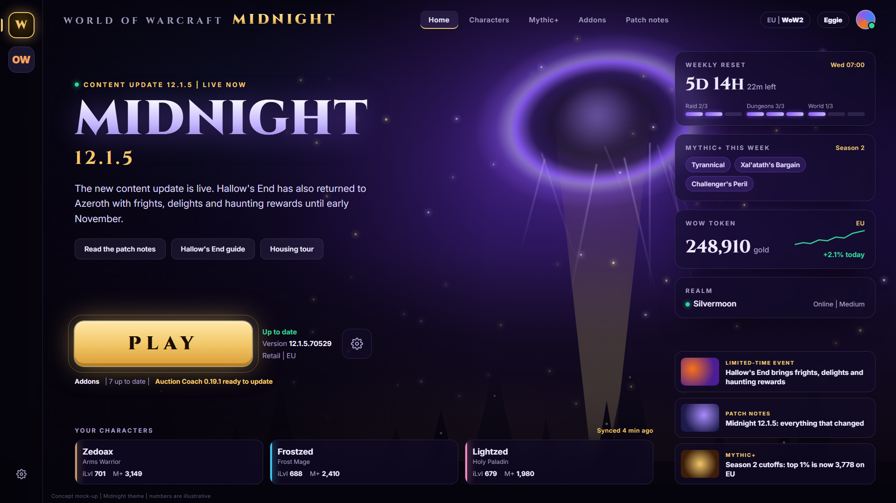

# Waygate

A game launcher that's worth opening. Waygate sits in front of Battle.net and dresses itself in the
current content of each game: for World of Warcraft right now that's Midnight, with the void, the
Sunwell and Quel'Thalas gold. Next expansion, a new theme pack and it looks the part again.

> Status: in development. The image above is a concept mock-up; the numbers in it are made up.

## What it does

- **Only your games.** Reads which Blizzard games you have installed and shows those, nothing else.
- **Play.** Starts the game through Battle.net, which stays in the tray where it belongs.
- **Themes per patch.** Each game has a theme pack (colours, background, logo, accent, optional
  ambient sound), picked by the game's current version.
- **What matters this week:** the weekly reset countdown and Great Vault, Mythic+ affixes, the WoW
  Token price and your realm's status.
- **Your characters:** item level and Mythic+ score, from Raider.IO by the names you type in.
- **News for your game only:** patch notes and events, no ads for other games.
- **Your addons:** installed versions and whether an update is out.

## How it works

- Built with [Tauri](https://tauri.app): Rust for the engine, a web view for the window, so a theme can
  look like anything.
- Battle.net still has to run (it handles your login), but you don't have to look at it. Waygate
  starts games with Battle.net's own launch command and never modifies Battle.net or the games.
- Game data is public only: Blizzard's public patch server (to tell you when a game update is out),
  Blizzard's posts on the official forums (news), Raider.IO, and public game data such as affixes and
  the token price. No keys or accounts.

## Your account stays yours

Waygate never touches your Battle.net account. There's nothing to log in to, so there's nothing to steal.

- **No login.** Waygate never asks for your Battle.net email, password or authenticator, and has no
  "connect your account" button. You log in to Battle.net itself, the same as always.
- **Doesn't read Battle.net's files.** No passwords, tokens, cookies, settings or caches. Your installed
  games come from the standard Windows list of installed programs.
- **No hooks or injection.** It doesn't read memory, inject into, or automate Battle.net or the game.
  It starts a game with Battle.net's own launch command, the same thing a desktop shortcut does.
- **Read only.** It reads the game version and your addons' version numbers, and never writes to the
  game folder.

## Free for everyone

Every feature is free for everyone, with no paid version. If you'd like to support it, there's
[Ko-fi](https://ko-fi.com/ctrlshiftzed) and [Patreon](https://www.patreon.com/cw/CtrlShiftZed).

## Requirements

- Windows 10 or 11
- Battle.net installed and logged in

## Disclaimer

Waygate is a free fan project. It isn't made, endorsed or supported by Blizzard Entertainment.
World of Warcraft, Battle.net and related names and art are trademarks of Blizzard Entertainment.
